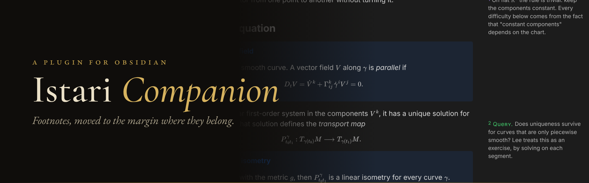
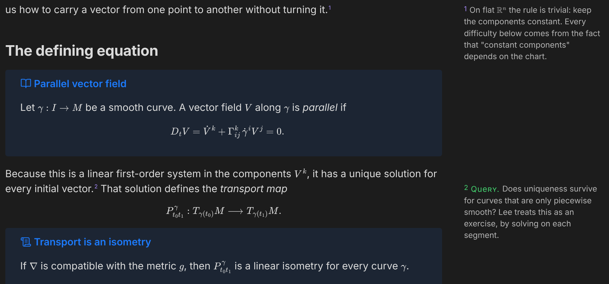
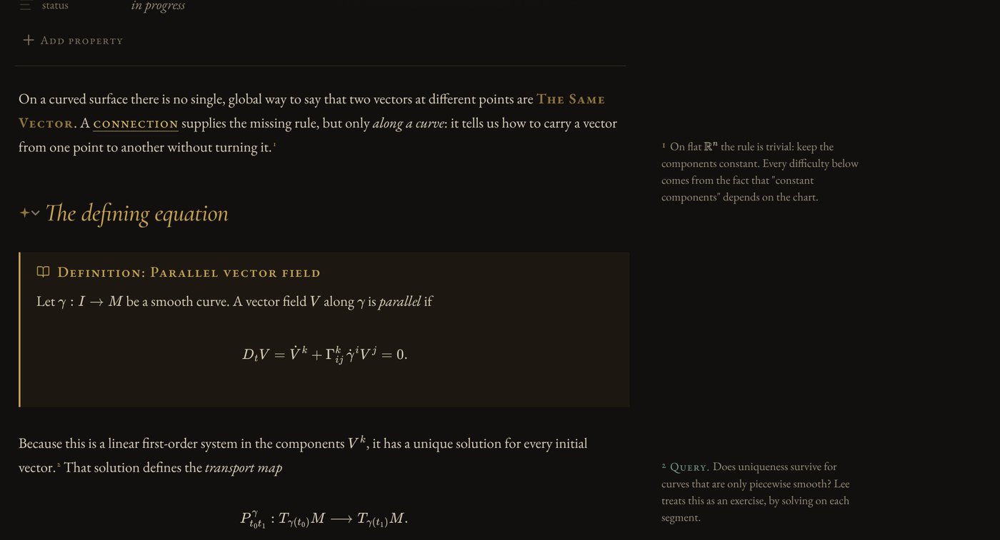
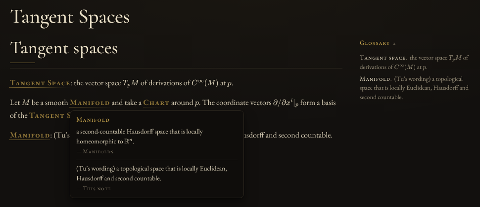
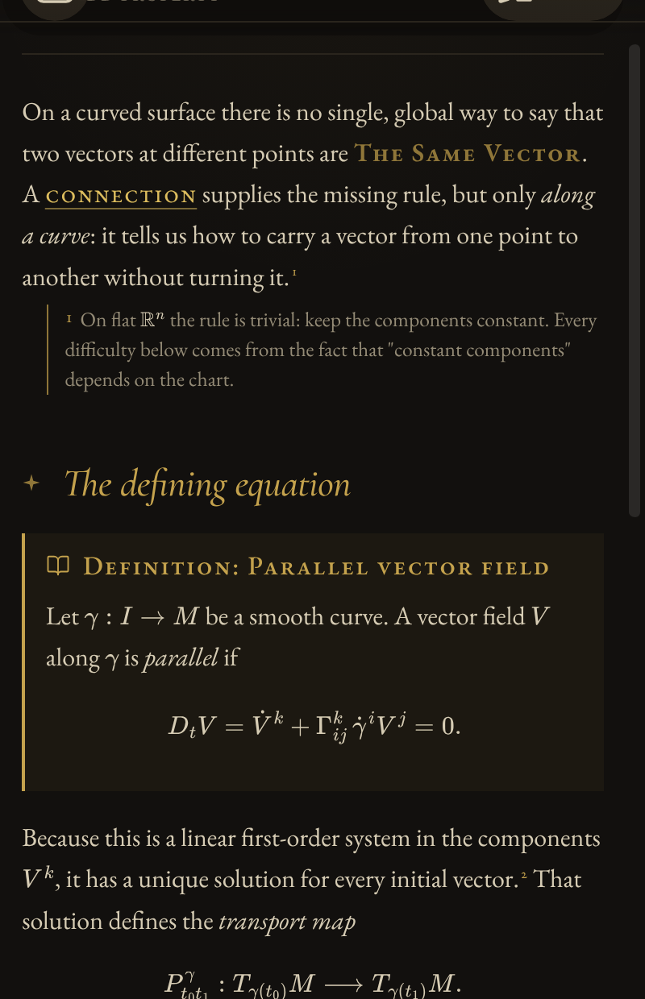

<p align="center"></p>

Footnotes are a good idea in the wrong place. You write an aside, and Obsidian sends it to the bottom of the page, where nobody, including you three weeks later, ever scrolls.

Istari Companion puts each footnote in the margin, next to the line it belongs to, the way Tufte sets his books and the way medieval readers annotated theirs. You keep writing ordinary Markdown footnotes. Nothing in your files changes.

It was built for the [Istari](https://github.com/TheScholium/istari) theme, but it works with any theme. Here it is with Obsidian's default:



## What it does

**Sidenotes, in Reading view and in Live Preview.** Inline footnotes (`^[like this]`) and labelled ones (`[^1]`) both move to the margin. In Live Preview, put your cursor on a footnote and its source comes back so you can edit it, the same way links and bold work.



**Queries.** Start a note with `? ` and it gets a green *Query* label. It is a small thing, but when every open question in a chapter looks different from every explanation, you can actually find them again.

```markdown
The solution is unique.^[? Does this still hold for piecewise smooth curves?]
```

**A glossary that writes itself.** Bold a term and follow it with a colon, and that line is a definition:

```markdown
**Geodesic**: a curve whose tangent vector is parallel along itself.
```

That is the only rule. Three things follow from it:

- The note's own terms appear in a small glossary at the top of the margin, above any sidenotes. Click a term to jump to its definition. In a narrow pane the glossary folds into one line above the text.
- A note named `Glossary` collects every term in the vault, alphabetized, each with a link back to the note that defines it. Each term is a heading, so `[[Glossary#Geodesic]]` links straight to it. If you have no such note, the plugin makes one: in your top-level `System` folder if there is one, otherwise at the top of the vault. Move or rename the folder it is in whenever you like; the plugin finds it by name.
- Anywhere you write a term in bold, in any note, a faint dotted rule marks it. Hover over it and its definition appears. Click the term in that card to open it in the Glossary.



**Narrow panes and phones.** The plugin measures each pane. Below 980 px there is no room for a margin, so the number becomes a button that opens the note right under its line.

<p align="center"></p>

**Callout shorthand.** Type `THEOREM` at the start of a line, then a space, a colon or Enter, and the line becomes `> [!theorem] `. One undo puts the word back. It also works for `DEFINITION`, `DEF`, `LEMMA`, `PROPOSITION`, `COROLLARY`, `PROOF`, `EXAMPLE`, `REMARK`, `AXIOM`, `CONJECTURE`, `INTUITION`, `EXERCISE` and `WARNING`.

**Untitled callouts.** Obsidian gives an untitled callout its type as a title, and CSS cannot tell that apart from a title you typed. The plugin marks those callouts, so a theme like Istari can show "Theorem:" once instead of "Theorem: Theorem".

**PDF export still works.** When you export, sidenotes print as normal footnotes at the end of the note.

## Install

**From Obsidian** (once the listing is approved): Settings → Community plugins → Browse → search for *Istari Companion* → Install → Enable.

**With BRAT**, today: install the [BRAT](https://github.com/TfTHacker/obsidian42-brat) plugin, choose *Add beta plugin*, and enter `TheScholium/istari-companion`.

**By hand**: download `main.js`, `manifest.json` and `styles.css` from the [latest release](https://github.com/TheScholium/istari-companion/releases/latest), put them in `<your vault>/.obsidian/plugins/istari-companion/`, restart Obsidian, and turn the plugin on under Community plugins.

## Good to know

- There are no settings. It either helps or you turn it off.
- It makes no network requests and collects nothing.
- The only note it writes is the Glossary, and it rebuilds that note from your definitions, so edit a definition where you wrote it, not in the Glossary. It never touches a note named Glossary that it did not make; if you already have one, it tells you and leaves it alone. The only other time it changes text is when you type a shorthand word, and that is one undo away.
- Matching is exact apart from capital letters: **Manifold** and **manifold** are the same term, but **manifolds** is not. Terms that contain math do not get a hover card.
- Footnotes inside tables, embeds and hover previews stay in place, because those have no margin to reach.
- Requires Obsidian 1.8 or later. Works on desktop and mobile.

## Building it yourself

```bash
npm install
npm run build   # writes main.js
npm run lint    # Obsidian's own ESLint rules
```

The source is in `src/`: `main.ts` (sidenotes, callouts), `glossary.ts` (finding terms; plain text, no Obsidian) and `glossary-view.ts` (the glossary in Obsidian). The styles are `styles.css`.

## License

[MIT](LICENSE). Made by [The Scholium](https://github.com/TheScholium), who also makes [Istari](https://github.com/TheScholium/istari) and [study templates](https://thescholium.github.io/scholium) for e-ink notebooks.
